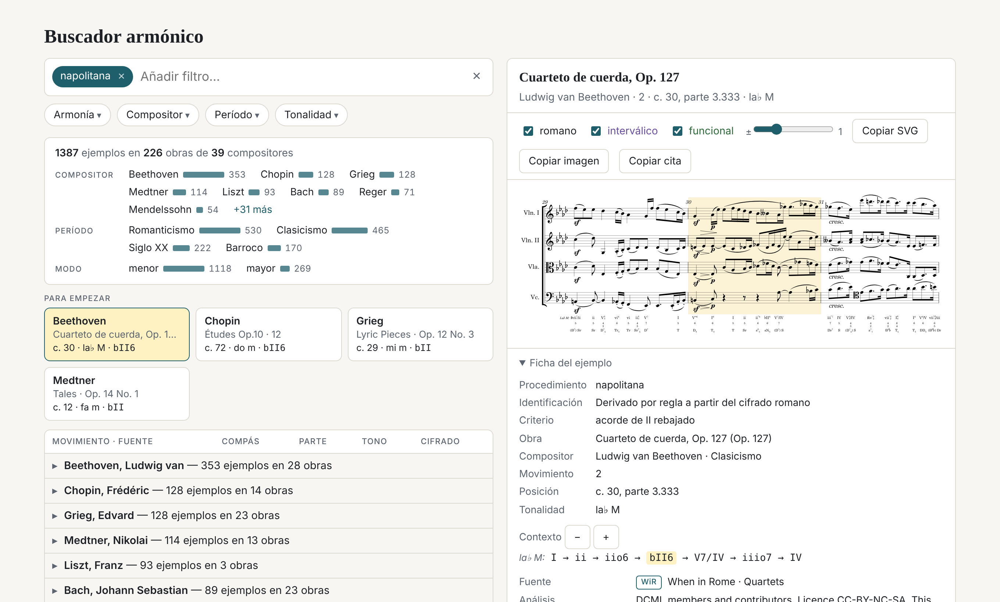
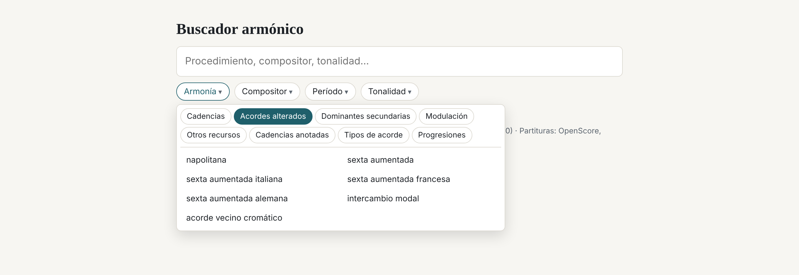
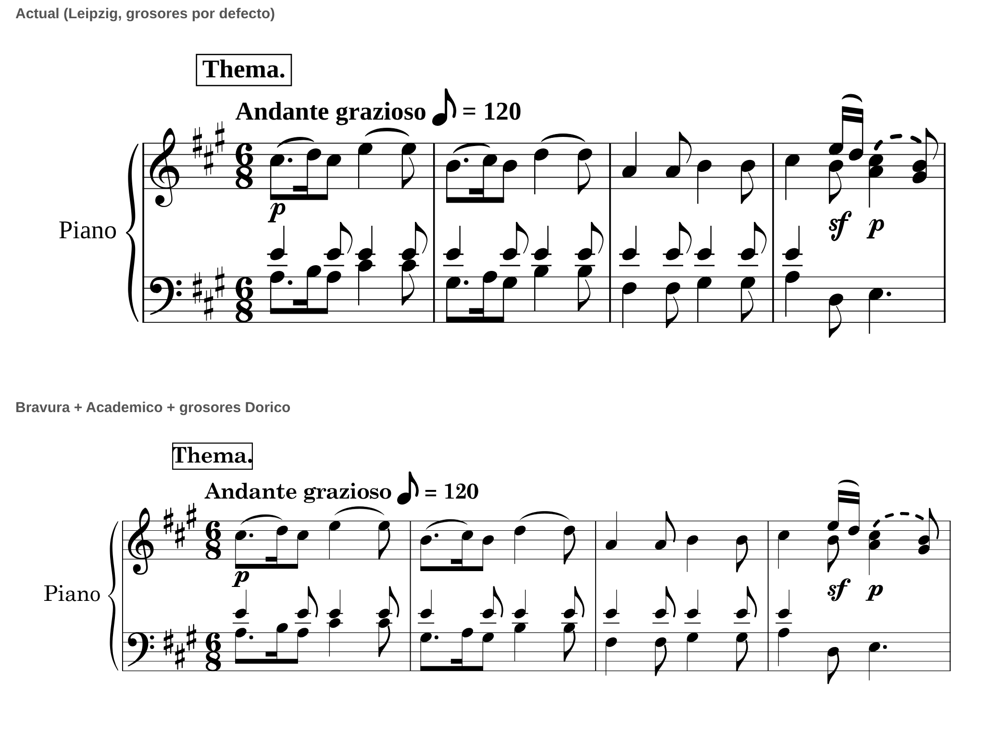

<p align="center"></p>
<h1 align="center">Harmony Finder</h1>
<p align="center"><i>Buscador armónico</i></p>

<p align="center">
  <b>Ejemplos reales de procedimientos armónicos, con su compás exacto y la partitura cifrada.</b><br>
  Para preparar clases de armonía, análisis y materiales de teoría.
</p>

<p align="center"><a href="https://enavcap.github.io/HarmonyFinder/"><b>▶ Abrir Harmony Finder en el navegador</b></a></p>

<p align="center">
  
</p>

<p align="center">
  
  
  
  
</p>

---

## Qué hace

Eliges un procedimiento armónico (una napolitana, una cadencia rota, una modulación enarmónica, una progresión `ii6 V7 I`…) y aparecen ejemplos del repertorio, de Monteverdi a Bartók, con la obra, el compás, la parte, la tonalidad y el cifrado. Al pulsar un ejemplo se dibuja la partitura con tres cifrados alineados bajo el pentagrama:

- **romano** (V⁶₅/V, ♭II⁶, Ger⁶₅…)
- **interválico** (cifrado de bajo continuo)
- **funcional** (T, S, D, DD, sN, Đ⁷…)

El fragmento se copia como **SVG** o imagen para pegarlo en un libro o una presentación.

La web está **en español y en inglés** (botón junto al título). El buscador entiende los dos idiomas sea cual sea el de la interfaz, y una búsqueda da exactamente los mismos resultados en uno y otro: «sexta alemana en el desarrollo» y «German sixth in the development» son la misma búsqueda.

## Cómo se busca



- **Una sola caja con etiquetas.** Escribes y eliges: `napolitana` + `Mozart` + `modo menor`. Cada elección queda como etiqueta que se puede quitar.
- **Seis desplegables** para explorar sin conocer el vocabulario:
  - **Armonía**: cadencias, acordes alterados, dominantes secundarias, modulación, otros recursos, cuatríadas, tipos de acorde y progresiones.
  - **Compositor**: buscador y lista por período.
  - **Período**.
  - **Tonalidad**: nota + ♭ ♮ ♯ + mayor/menor.
  - **Etiquetas dinámicas**: los menús y las sugerencias solo ofrecen las opciones que dan algún resultado con lo ya elegido, con su número. Con «Mozart», el menú Forma deja de ofrecer fuga o coral; con «forma sonata», solo quedan los compositores que la tienen. Cada opción se calcula con los demás filtros (sin el suyo), sobre los ejemplos de la búsqueda actual o, si no hay, sobre los movimientos. Los procedimientos del menú Armonía se recalculan al abrirlo.
  - **Forma**: la forma global del movimiento (forma sonata, rondó, minueto con trío, scherzo con trío, tema con variaciones, forma binaria, ternaria, fuga, coral). Se combina con compositor, tonalidad y procedimiento: «forma sonata» + «Mozart» + «la menor» da la sonata n.º 8, K. 310; «sexta napolitana en forma sonata» busca dentro de esos movimientos. Solo se asigna cuando una fuente lo dice (Taking Form, BPSD, el Mozart Expositional Punctuation Corpus, el título del movimiento o el género de la colección); el resto queda sin forma hasta revisarlo (`multicorpus/formas_revisadas.tsv`).
  - **Secciones**: sección (exposición, desarrollo, reexposición, coda, trío…) y zona (primer grupo temático, transición, segundo grupo temático, zona conclusiva, retransición…). Se combina con cualquier procedimiento, también escribiéndolo: «sexta alemana en el desarrollo», «modulación diatónica en la exposición». Acepta las siglas de la teoría de la sonata (P, TR, S, C).
- **Resultados que se leen de un vistazo**:
  - resumen con barras por compositor, período y modo (pulsar una barra filtra);
  - cuatro ejemplos destacados;
  - lista plegada compositor → obra → ejemplos.
- **Ficha de cada ejemplo**: criterio de detección, contexto armónico, fuente, analistas, versión y licencia.
- **Comparador de análisis** cuando una obra está analizada en los dos corpus (Winterreise, Kindertotenlieder, madrigales de Monteverdi…).
- **Colecciones personales** con comentario, etiquetas y valoración.

### Procedimientos detectados

| Familia | Conceptos |
|---|---|
| Cadencias | auténtica perfecta e imperfecta, rota, semicadencia, frigia, plagal, 6/4 cadencial |
| Acordes alterados | napolitana (♭II en cualquier posición), sexta napolitana (♭II6) y ♭II en estado fundamental, cada uno también → V; sextas aumentadas italiana / francesa / alemana (y → 6/4), intercambio modal |
| Dominantes secundarias | dominante secundaria (resuelta o no), dominante de la dominante, séptima disminuida secundaria |
| Modulación | diatónica, cromática, enarmónica (verificada con la grafía de la partitura), directa; a relativo, dominante, homónimo, tercera |
| Otros | secuencia de quintas, pedal de dominante, acorde disminuido, aumentado, sexta añadida |
| Cuatríadas | séptima de dominante, disminuida, semidisminuida, menor (menor con 7ª menor) y mayor (mayor con 7ª mayor), diatónicas o secundarias |
| Pasajes por tipo de acorde | tríadas / cuatríadas, inversiones, prestados, secundarias, alterados, modulación — combinables |
| Progresiones | cualquier sucesión en cifrado romano, con acordes intermedios. Solo se exige lo que se escribe: `ii V I` encuentra también `ii6 V7 I` o `ii7 V4/3 I`; `ii6`, `iiø7` o `V43` filtran por inversión y cualidad. El grado, la alteración, la dominante secundaria y la mayúscula/minúscula siempre cuentan, y la progresión no cruza una modulación (`web/progresiones.js`) |

## Grabado

Las partituras se dibujan en el navegador con [Verovio](https://www.verovio.org), con la fuente musical **Bravura** y el texto en **Academico** (las de Dorico, ambas con licencia SIL OFL) y grosores de línea al estilo de Dorico.



## Datos

| Corpus | Análisis | Licencia |
|---|---|---|
| [When in Rome](https://github.com/MarkGotham/When-in-Rome) (Gotham et al., RomanText) | 1834 | CC BY-SA 4.0 |
| [Distant Listening Corpus](https://github.com/DCMLab/distant_listening_corpus) (DCML, EPFL), 28 subcorpus | 746 | CC BY-NC-SA 4.0 |
| [Taking Form](https://github.com/MarkGotham/Taking-Form) (Gotham e Ireland), forma | 54 movimientos | MIT |
| [BPSD](https://transactions.ismir.net/articles/196) (Zeitler et al.), estructura de los primeros movimientos de las sonatas de Beethoven (tabla 3 del artículo) | 32 movimientos | CC BY 4.0 |
| [Mozart Expositional Punctuation Corpus](https://github.com/corpusTAU/The-Mozart-Expositional-Punctuation-Corpus) (Rom, Raz y Chawin), exposiciones en forma sonata de Mozart | 298 movimientos | CC0 |

- **Modelo común** obra → movimiento → análisis. Una obra puede tener análisis de las dos fuentes.
- **Identificación de obras en tres niveles**:
  1. catálogo o identificador externo;
  2. título normalizado;
  3. parecido, que solo genera candidatos para revisión manual, nunca fusiones automáticas.
- **Trazabilidad**:
  - se conserva la etiqueta original de cada analista;
  - los campos derivados están marcados;
  - cada análisis guarda archivo, commit, autores y licencia.
- **Forma**: [Taking Form](https://github.com/MarkGotham/Taking-Form) (Gotham e Ireland, ISMIR 2019; MIT), con la forma de las sonatas para piano de Beethoven y de los primeros movimientos de Mozart. Se usan sección y zona. Un movimiento entra solo si su numeración se puede comprobar con la partitura: el último compás anotado coincide con el de la partitura, o el primer acorde de la reexposición coincide con el de la exposición. Así entran 54 movimientos; 13 se dejan fuera.
- **Forma global de expertos**: [BPSD](https://transactions.ismir.net/articles/196) (Zeitler et al., TISMIR 2024) da la estructura del primer movimiento de las 32 sonatas de Beethoven (E-D-R → forma sonata; Op. 26 → tema con variaciones). El [Mozart Expositional Punctuation Corpus](https://github.com/corpusTAU/The-Mozart-Expositional-Punctuation-Corpus) (Rom, Raz y Chawin, EMR 2021; CC0) lista los movimientos de Mozart en forma sonata-allegro con el inicio y la longitud de la exposición; donde Taking Form no llega, la exposición pasa también a «Secciones». En los 15 movimientos que tienen ambas fuentes, el final de la exposición coincide compás a compás. El MEPC deja fuera los movimientos lentos y los rondós-sonata, así que no estar en él no significa no ser forma sonata. Los datos de compases de BPSD (secciones) están en un zip de 2 GB con audio en Zenodo y aún no se usan.
- **Vocabulario**: cada término (procedimientos, tipos de acorde, filtros, forma) tiene una clave interna y su nombre, descripción y sinónimos en español e inglés (`multicorpus/vocabulario.py`, exportado a `web/data/vocab.json`).
- **Partituras**:
  - las de When in Rome vienen de OpenScore y music21;
  - las del DCML se reconstruyen desde sus tablas de notas (sin dinámicas ni articulaciones).
  - en las reconstruidas, las claves se eligen como lo haría un copista: las propias de cada instrumento (violonchelo en fa, tenor o sol; viola en do; tenor vocal en sol octava baja; teclado en sol y fa), con cambios de clave en la barra de compás para evitar pasajes con tres o más líneas adicionales.

## Estructura

```
multicorpus/          catálogo multicorpus (modelo, identificación, adaptadores, importación, exportación, pruebas)
  adaptadores/        When in Rome (RomanText) y DCML (TSV)
  tests/              pruebas automáticas (pytest)
  README.md           uso del catálogo · INFORME.md: informe técnico
  vocabulario.py      términos en español e inglés (claves canónicas, sinónimos, forma)
  cadencias.py        cadencias como finales de frase (rasgos de partitura)
  unisonos.py         pasajes al unísono u octava
  forma.py            secciones de Taking Form, alineadas con las partituras
  forma_global.py     forma global de cada movimiento y numeración tradicional de sonatas y cuartetos
buscar.py             detectores armónicos sobre la secuencia de acordes
indexar.py            lectura de RomanText con music21
herramientas/         conversión de tablas DCML y Humdrum a MusicXML; prueba_idiomas.py (mismos resultados en los dos idiomas);
                      prueba_progresiones.js (búsqueda de progresiones sobre los datos reales);
                      prueba_canonicos.js («Para empezar»: ejemplos canónicos y variados)
web/                  aplicación estática (index.html + data/ + scores/ + fonts/)
docs/img/             imágenes de esta portada
VERSION               versión vigente (Semantic Versioning); CHANGELOG.md: historial de cambios
```

## Uso

**La web** es estática y funciona tal cual:

```bash
cd web && python3 -m http.server 8000      # http://localhost:8000
```

**Regenerar los datos** (necesita las fuentes; ver `multicorpus/README.md`):

```bash
pip install music21 pytest
python -m multicorpus.importar wir
python -m multicorpus.importar dcml
python -m multicorpus.auditar            # posibles duplicados
git clone https://github.com/MarkGotham/Taking-Form datos/fuentes/taking_form   # secciones
git clone https://github.com/corpusTAU/The-Mozart-Expositional-Punctuation-Corpus datos/fuentes/mepc   # exposiciones de Mozart
# títulos de movimiento de Beethoven y Mozart (forma global): metadata.tsv de DCMLab/beethoven_piano_sonatas
# y DCMLab/mozart_piano_sonatas en datos/fuentes/dcml_meta/<repositorio>/metadata.tsv
python -m multicorpus.exportar_mc        # genera web/data y web/scores
python -m pytest -q multicorpus/tests
python herramientas/prueba_idiomas.py    # en navegador: español e inglés dan lo mismo
node --test herramientas/prueba_progresiones.js   # progresiones: ii V I, inversiones, cualidades, sin duplicados
node --test herramientas/prueba_canonicos.js      # «Para empezar»: compositores distintos, un Bach, cadencias claras
```

**Versiones.** El proyecto sigue [Semantic Versioning 2.0.0](https://semver.org/lang/es/): la versión vigente está en [`VERSION`](VERSION) y el historial en [`CHANGELOG.md`](CHANGELOG.md). El pie de la web la muestra a partir de `web/version.js`, que se regenera con `herramientas/sincronizar_version.py`.

## Limitaciones

- No hay detectores de contrapunto, imitación ni esquemas galantes: los corpus no los anotan.
- **Cadencias.** Se buscan como finales de frase, no como cualquier V–I: además del cifrado se mira la partitura. La llegada tiene que caer en parte fuerte (primera o mitad del compás) y durar al menos lo mismo que el acorde anterior; las auténticas, ir preparadas por un predominante (ii, IV, 6/4 cadencial, V/V, sexta aumentada, napolitana). La perfecta y la imperfecta se distinguen por el tiple (tónica o no al llegar, admitiendo una apoyatura por grado conjunto); la frigia comprueba el bajo (6.º → 5.º); la semicadencia pide además que la melodía se detenga y descarta las prolongaciones del V. Contra las cadencias que anotan los analistas del DCML, la auténtica perfecta acierta en un 81 % de los casos (antes, un 32 %); la semicadencia, la rota y la plagal son menos fiables, porque dependen de rasgos de frase que la partitura no siempre muestra. El **6/4 cadencial** es un I en segunda inversión (o un Cad64 anotado) seguido de V(7) y de un I de llegada al final de frase, con el mismo criterio de llegada; el 6/4 tiene que estar acentuado (parte al menos tan fuerte como la del V, o más largo) y con el 5.º grado en el bajo. Los 6/4 de paso, de bordadura o arpegiados quedan fuera: de 8.357 ejemplos se pasa a 3.561, y el 86 % va seguido de una cadencia anotada por el DCML (antes, el 63 %). Los 6/4 de las semicadencias (I64 → V sin resolver) no se cuentan.
- **Pasajes al unísono u octava.** Cuando varias voces o instrumentos doblan la misma línea, el analista suele cifrar la armonía implícita nota a nota, a veces con cambios de tonalidad. Esos acordes se detectan en la partitura (≥2 acordes seguidos en los que solo suenan notas dobladas, salvo que la línea arpegie el propio acorde) y no cuentan en los procedimientos derivados, las progresiones ni los pasajes por tipo de acorde: ninguna detección atraviesa el pasaje. En la partitura esos cifrados se ven atenuados. No se aplica a obras con bajo continuo sin realizar (Schütz, Peri, Corelli, *Concerts royaux*), donde la partitura solo trae el bajo.
- En pasajes muy polifónicos de las partituras reconstruidas del DCML (3–4 voces en un pentagrama) puede haber choques de notas.
- La fecha de composición solo consta en unas 190 obras; se filtra por período.

## Licencias y créditos

- Análisis: **When in Rome** (CC BY-SA 4.0) y **Distant Listening Corpus, DCML** (CC BY-NC-SA 4.0). Forma: **Taking Form** (MIT), **BPSD** (CC BY 4.0) y **Mozart Expositional Punctuation Corpus** (CC0). Por la licencia del DCML, los datos de `web/` solo pueden usarse sin fines comerciales, con atribución y compartiendo igual.
- Partituras: OpenScore, corpus de music21 y reconstrucciones a partir de las tablas del DCML. 57 movimientos de las sonatas para piano de Beethoven (129 análisis) usan en su lugar la codificación Humdrum de Craig Sapp ([beethoven-piano-sonatas](https://github.com/craigsapp/beethoven-piano-sonatas), de la edición Durand 1915, P. Dukas), convertida con `herramientas/krn_beethoven_a_mxl.py`. **Pendiente:** ese repositorio no declara licencia; hay que confirmarla con su autor antes de publicar.
- Fuentes: Bravura y Academico (Steinberg, SIL Open Font License 1.1).
- Grabado: Verovio (LGPL).

---

<p align="center"><sub>Ezequiel Navarrete</sub></p>
